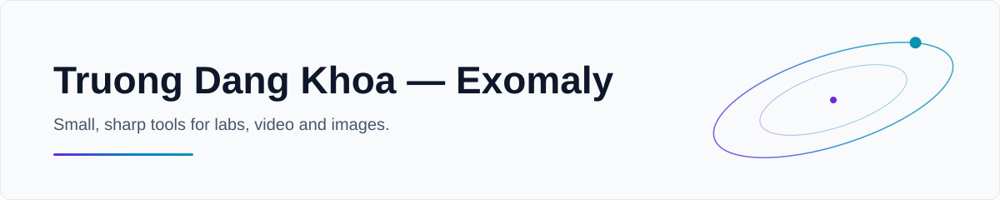

[English](README.md) · Tiếng Việt

<picture>
  <source media="(prefers-color-scheme: dark)" srcset="assets/banner-dark.svg">
  <source media="(prefers-color-scheme: light)" srcset="assets/banner-light.svg">
  
</picture>

Tôi là Truong Dang Khoa, làm Data Science và xây các công cụ phần mềm, web thực dụng dưới thương hiệu Exomaly ([exomaly.com](https://exomaly.com)): một hệ thống cho phòng thử nghiệm có dự đoán thời gian trả kết quả và phát hiện kết quả bất thường, cùng các công cụ tiện dụng xử lý file ngay trên máy của bạn. Bản miễn phí không cần tài khoản.

## Hệ thống & dữ liệu

| Sản phẩm | Làm gì | Địa chỉ |
|---|---|---|
| **Exomaly LIMS** | Quản lý phòng thử nghiệm theo ISO/IEC 17025: nhận mẫu, kết quả, soát xét, phiếu kết quả; dự đoán thời gian trả kết quả và phát hiện kết quả bất thường | [lims.exomaly.com](https://lims.exomaly.com) |
| **Exomaly Geulbit** | Dịch chữ Hàn trong ảnh sang tiếng Việt: chụp hoặc chọn ảnh, bản dịch hiện đè lên đúng chỗ chữ gốc, kèm từ vựng | [geulbit.exomaly.com](https://geulbit.exomaly.com) |

## Công cụ web & media

| Sản phẩm | Làm gì | Địa chỉ |
|---|---|---|
| **Exomaly Infall** | Tải video (đến 4K) và ảnh từ YouTube, Facebook, Instagram, TikTok, X, Pinterest hoặc tách âm thanh MP3 / M4A; có app Windows và bản web | [infall.exomaly.com](https://infall.exomaly.com) |
| **Exomaly Remux** | Sửa container của file MP4 trước khi đăng lên TikTok; hình và tiếng giữ nguyên từng byte | [upload.exomaly.com](https://upload.exomaly.com) |
| **Exomaly Upscale** | Phóng ảnh lên 2K hoặc 4K ngay trong trình duyệt, ảnh không rời khỏi máy bạn | [upscale.exomaly.com](https://upscale.exomaly.com) |

Mã nguồn các sản phẩm nằm ở kho riêng tư. Bản phát hành của Infall có tại [exomaly-download](https://github.com/TruongDangKhoa-DS/exomaly-download).

## Sắp ra mắt

- **Exomaly Deck**: bàn điều khiển âm thanh cho sự kiện, chạy ngay trong trình duyệt và không cần mạng: nhạc nền, hiệu ứng, fade, crossfade, phím tắt sân khấu, dò BPM và tone. Thiết kế gốc bởi HoangPham; Exomaly tích hợp và chỉnh sửa.
- **Exomaly Epochfold**: quay màn hình kèm âm thanh hệ thống, mic và webcam; cắt đoạn, zoom và xuất MP4 đến 60 khung hình/giây; có bản web (Chrome, Edge) và bản Windows.

## Phần mềm tự thiết kế cho riêng tôi

Các phần mềm tôi tự thiết kế để dùng cá nhân trên máy của mình, không phát hành và không có địa chỉ công khai.

| Phần mềm | Làm gì |
|---|---|
| **Exomaly Signal** | Bảng theo dõi nằm cạnh khung chat trong VS Code: việc đang chạy, lệnh nền, lượng ngữ cảnh đã dùng và các phiên khác đang mở trên máy |
| **Exomaly Orbit** | Ứng dụng Windows chỉ đọc: theo dõi nhánh git, commit chờ push và tiến trình nặng trên máy, báo qua thông báo Windows, có bảng điều khiển 3D |
| **Exomaly Ephemeris** | Mặt đồng hồ cho Garmin Forerunner 165: màu hành tinh trên nền đen, viết bằng Monkey C |

## Cách các sản phẩm được làm

Mỗi sản phẩm có một hồ sơ kỹ thuật ngắn: số liệu thật, các quyết định thiết kế kèm phương án đã loại, và cách kiểm chứng. Xem [ghi chú kỹ thuật](https://truongdangkhoa-ds.github.io/TruongDangKhoa-DS/) của từng sản phẩm.

## Liên hệ

`tdk.exomaly@gmail.com` · [Facebook](https://www.facebook.com/Exomaly) · [Nhắn tin trên Zalo](https://zalo.me/0334934592)
